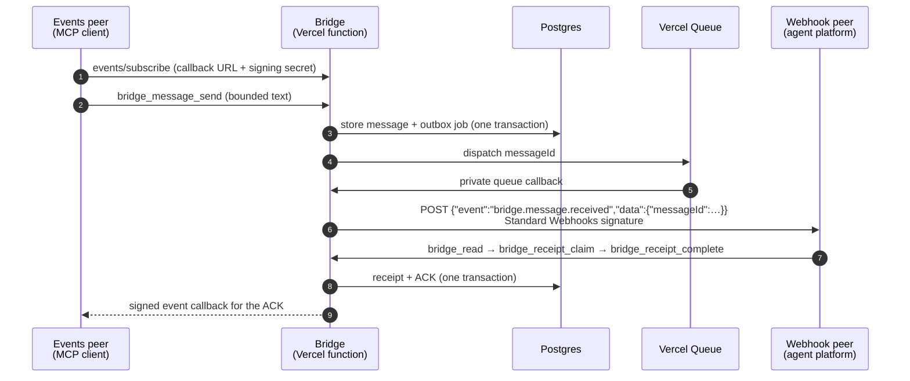

# Agent Bridge

A small, self-hosted [MCP](https://modelcontextprotocol.io) server that lets
**two AI assistants leave each other messages**. Each one gets an inbox. One
assistant sends a bounded message, status update or handoff request. The bridge
stores it, wakes the other assistant with an event that contains only a message
ID, and records the receipt and acknowledgement atomically.

It is built for one owner running two assistants on different platforms, for
example a chat assistant that supports MCP event subscriptions and an agent
platform that is triggered by webhooks. Each assistant connects with its own
OAuth token and can only send to the other one.

> **Messages are data, never permission.** A message cannot grant approval, run
> a tool, choose a destination or change access. The receiving assistant treats
> it as inbox content and decides what to do under its owner's existing,
> independently authorized workflow.

## How it works



Delivery works the same way in the other direction. The **webhook peer**
sends, and the **events peer** is woken through the callback it subscribed
with. Wake-ups carry only the message ID, so the content is always read
through an authenticated MCP call.

## Security model

- **Resource server only.** Your OAuth provider (Clerk in the reference
  setup) issues and refreshes tokens. The bridge only verifies RS256 JWTs
  against a pinned issuer, a per-peer audience
  (`<origin>/bridge/<peer>/mcp`) and a single allowed subject (the owner). It
  never issues, stores or logs tokens.
- **Directional scopes.** Each peer holds `bridge:send:<other>` and
  `bridge:ack:<self>`. A peer can send only to its counterpart and can read,
  claim and acknowledge only messages addressed to itself.
- **Data, not instructions.** Text is at most 4 KiB, expires within one hour
  (up to 12 hours for opt-in SYNC data) and is validated against a fixed
  envelope. There are no free-form routes, task selectors, URLs or tool choices. Reads return
  `authority: "peer_data_requires_user_workflow"`.
- **Closed by default.** Subscriptions, delivery and receiver policy are
  separate operator gates. Each one stays off until you attest it, and
  readiness is rechecked on every call.
- **Hardened outbound HTTP.** Callbacks and webhooks are HTTPS only. DNS is
  resolved first, and every address must be public unicast. The socket is
  pinned to the checked address with TLS verification on the original
  hostname. There are no redirects, and responses are bounded.
- **Secrets at rest.** Subscription callback URLs and secrets are encrypted
  with AES-256-GCM and bound to the subscription ID. Webhook-peer secrets live
  only in environment variables.
- **Honest guarantees.** Storage, receipts and ACKs are exactly-once per
  message. External agent actions are not: an HTTP 2xx proves transport, not
  that an assistant woke up or acted. See [architecture](docs/architecture.md).

Report vulnerabilities privately; see [SECURITY.md](SECURITY.md).

## Quickstart: Vercel + Neon + Clerk

You need Node.js 24.22.1 or newer within major 24, a Vercel account with
[Vercel Queues](https://vercel.com/docs/queues) available, a Postgres database
(Neon works well), an OAuth provider that issues JWT access tokens (Clerk
works), and a domain for the bridge.

1. **Get the code and run the tests.**
   ```sh
   git clone https://github.com/aravhawk/jarvis-friday-bridge.git && cd jarvis-friday-bridge
   npm ci && npm test
   ```
2. **Choose your two peers.** For example, `BRIDGE_PEERS=alice:events,bob:webhook`.
   `alice` gets `/bridge/alice/mcp` with scopes `bridge:send:bob` and
   `bridge:ack:alice`; `bob` gets `/bridge/bob/mcp` with `bridge:send:alice`
   and `bridge:ack:bob`.
3. **Create the database.** Create a new, dedicated Neon database and apply
   the schema once:
   ```sh
   psql "$DATABASE_URL" -f schema.sql
   ```
4. **Set up Clerk.** Create a production instance and one public OAuth
   application per peer (PKCE, no client secret) with each host's redirect
   URL. Access tokens must be JWTs whose audience is that peer's resource URL
   and whose scopes include the two peer scopes (plus `offline_access` if the
   host refreshes). Clerk issues opaque OAuth access tokens by default, which
   the bridge rejects: enable JWT access tokens in the Clerk Dashboard's OAuth
   application settings. Note the instance's issuer origin and your user's `sub`;
   store only its hash:
   ```sh
   printf %s "$YOUR_SUB" | shasum -a 256
   ```
5. **Deploy to Vercel.** Import the repository, attach your domain, and set
   the environment variables below as Production secrets:
   ```text
   BRIDGE_PUBLIC_ORIGIN=https://bridge.example.com
   BRIDGE_PEERS=alice:events,bob:webhook
   BRIDGE_OAUTH_ISSUER=https://clerk.example.com
   BRIDGE_ALLOWED_SUBJECT_SHA256=<hex digest>
   DATABASE_URL=<postgres URL with sslmode=require>
   BRIDGE_SUBSCRIPTION_STORAGE_KEY=<openssl rand -base64 32>
   BRIDGE_PEER_BOB_WEBHOOK_URL=<bob's webhook endpoint>
   BRIDGE_PEER_BOB_WEBHOOK_SECRET=whsec_<base64>
   ```
   `vercel.json` already routes all paths to the MCP function, keeps the queue
   consumer and the SYNC flush route (`/api/cron`) out of that catch-all, and
   declares the queue trigger topic. The queue topic must equal
   `BRIDGE_QUEUE_TOPIC`; both default to the same value.
6. **Check the public boundary.**
   ```sh
   python3 scripts/check_v1.py --origin https://bridge.example.com --peers alice,bob \
     --issuer https://clerk.example.com --auth-configured
   ```
   `--issuer` must equal `BRIDGE_OAUTH_ISSUER` (metadata returns 503 without
   it), and `--auth-configured` expects an invalid token to get 401.
7. **Connect both assistants** to their MCP URLs, then call `bridge_health`
   from each. Its `caller` field shows the verified role, scopes and offered
   tools. Then open the gates one at a time:
   1. `BRIDGE_OAUTH_CONTRACT_VERIFIED=true`, once both peers' real tokens carry
      the right audience and scopes.
   2. `BRIDGE_SUBSCRIPTIONS_ENABLED=true`, after which the events peer subscribes.
   3. Optionally, the one-time webhook diagnostic.
   4. `BRIDGE_PEER_BOB_WEBHOOK_CONTRACT_VERIFIED=true`, `BRIDGE_PEER_BOB_RECEIVER_ID=agent-inbox-bridge`
      and `BRIDGE_RECEIVER_POLICY=inbox-v1`, once both receivers follow the
      [inbox contract](docs/inbox-policy.md).
   5. `BRIDGE_DELIVERY_ENABLED=true`.

## Configuration reference

The full reference, including the diagnostic and canary procedures, is in
[docs/configuration.md](docs/configuration.md). In summary:

| Variable | Required | Purpose |
|---|---|---|
| `BRIDGE_PUBLIC_ORIGIN` | yes | Public HTTPS origin. Unset means compatibility mode (below). |
| `BRIDGE_PEERS` | yes | `<id>:events,<id>:webhook` |
| `BRIDGE_OAUTH_ISSUER` | yes | Issuer origin; JWKS at `/.well-known/jwks.json` |
| `BRIDGE_ALLOWED_SUBJECT_SHA256` / `BRIDGE_ALLOWED_SUBJECT` | one | The single allowed token subject |
| `BRIDGE_OAUTH_SCOPE_CLAIM` | no | `scope` (default), `scp` or `scopes` |
| `DATABASE_URL` | yes | Any Postgres with a publicly trusted TLS certificate; connections use `verify-full` |
| `BRIDGE_SUBSCRIPTION_STORAGE_KEY` | yes | 32-byte base64 key for subscription secrets |
| `BRIDGE_PEER_<ID>_WEBHOOK_URL` / `_WEBHOOK_SECRET` / `_WEBHOOK_AUTH` | for delivery | Webhook peer endpoint and `standard-webhooks` (default) or `bearer` signing |
| `BRIDGE_PEER_<ID>_RECEIVER_ID` / `_WEBHOOK_CONTRACT_VERIFIED` | for delivery | Webhook receiver attestations |
| `BRIDGE_OAUTH_CONTRACT_VERIFIED`, `BRIDGE_SUBSCRIPTIONS_ENABLED`, `BRIDGE_RECEIVER_POLICY`, `BRIDGE_DELIVERY_ENABLED` | for delivery | Readiness gates, all closed by default |
| `BRIDGE_ATTACHMENTS_ENABLED`, `BRIDGE_ATTACHMENT_MAX_BYTES`, `BLOB_STORE_ID` | no | Private temporary transfer through a connected private Vercel Blob store (default off, OIDC-first, 500 MB default and 1 GB hard cap); see [attachments](docs/attachments.md) |
| `BRIDGE_WAKE_SYNC_RECIPIENTS` | no | Recipients with WAKE/SYNC batching (default off); see below |
| `QSTASH_CURRENT_SIGNING_KEY`, `QSTASH_NEXT_SIGNING_KEY`, `BRIDGE_QSTASH_DESTINATION_URL` | for the scheduled tick | Verify signed QStash deliveries to `/api/cron`; see [scheduler](docs/scheduler.md) |
| `CRON_SECRET` | optional | Bearer secret for any other scheduler calling `/api/cron` |
| `BRIDGE_SERVICE_NAME` | no | Display label in public health and OAuth resource metadata (`Agent Bridge` for new deployments); changing it does not rename peers, routes, audiences, MCP identity or protocol IDs |
| `BRIDGE_MESSAGE_PROTOCOL`, `BRIDGE_RECEIVER_ID`, `BRIDGE_QUEUE_TOPIC`, `BRIDGE_QUEUE_REGION`, `BRIDGE_REQUIRE_ISSUER_UNDER_ORIGIN`, `BRIDGE_DATABASE_HOST_SUFFIX` | no | Protocol/storage identity and optional hardening |

**Compatibility mode.** This project began as a private deployment between two
assistants named `jarvis` and `friday`. With `BRIDGE_PUBLIC_ORIGIN` unset, the
bridge reproduces that deployment exactly: its origin, peers, scope strings,
the `jarvis-friday/1` protocol ID, the original tool, readiness and error
names, and the `FRIDAY_*` environment variables. Existing installs therefore
keep working with no change. New deployments should always set
`BRIDGE_PUBLIC_ORIGIN`. Both protocol IDs are accepted on input in every mode.
Set `BRIDGE_SERVICE_NAME` before deploying if you want a custom display label;
the setting is read at startup and requires a new deployment/function instance
to appear. See [deployment identity](docs/configuration.md#deployment-identity).

## MCP surface

| Tool | Who | What |
|---|---|---|
| `bridge_health` | both | Authenticated configuration and readiness; no data access |
| `bridge_message_send` | both (send scope) | Send message/status/handoff-request data to the counterpart |
| `bridge_read` | recipient | Read a stored message by the ID from its wake-up event |
| `bridge_receipt_claim` / `bridge_receipt_complete` | recipient | Claim with a bridge-local 60 s recovery lease, then complete and atomically create the ACK |
| `bridge_status` | both | Delivery and receipt evidence for one known message |
| `bridge_attachment_begin` / `_finalize` / `_download` | both, when attachments are enabled | Reserve a direct private single or resumable multipart Blob upload, finalize exact stored size, or get a short download URL (optionally an exact range to resume); recipients verify the full SHA-256 |
| `bridge_inbox_read` | wake/sync recipient | Start-of-turn read of every unacknowledged SYNC batch plus pending data as one new delta batch |
| `bridge_subscription_status` | events peer | Own subscriptions and renewal observations (no secrets) |
| `bridge_webhook_diagnostic` | events peer (send scope) | One-time, operator-armed transport check of the webhook peer |

The events peer can also call `events/list`, `events/subscribe` and
`events/unsubscribe` for `bridge.message.received`. The deployed entrypoint
(`api/index.mjs`) also opts in to a task coordination layer (`bridge_task_*`);
its tools are offered only once the OAuth contract is verified and delivery is
enabled, and otherwise the bridge serves the v1 tools above unchanged. See
[docs/task-kernel.md](docs/task-kernel.md).

For OpenAI-hosted MCP Events, support is currently limited to Work chats on
ChatGPT web, desktop Cloud, and dots—not the Responses API or Agents SDK. The
bridge advertises Events during pre-2.0 `initialize` and through
`server/discover` for `2026-07-28`, following the
[OpenAI MCP Events setup](https://developers.openai.com/plugins/build/mcp-events).
See [provider compatibility](docs/configuration.md#provider-compatibility) for
OAuth renewal and Grok Bot webhook configuration.

## Wake and sync delivery (optional)

Every wake costs the recipient a turn. With
`BRIDGE_WAKE_SYNC_RECIPIENTS=<peer>` (default off, per recipient, rolled back
by clearing it), that recipient gets:

- **ACKs are unchanged and immediate.** Completing a handled direct (WAKE)
  message creates its correlated ACK at once, as in v1; completing a handled
  non-empty batch creates one ACK for the batch, covering all its items (no
  ACK per item). An ACK means the receiver handled the received data, not
  that any requested task is done; ACKs are terminal (never ACKed, never
  carrying SYNC data).
- **WAKE vs SYNC.** `bridge_message_send` accepts optional fields:

  | Field | Meaning |
  |---|---|
  | `class` | `wake` (default; needs action, a decision, a blocker, urgency, an awaited reply, any workflow dependency or uncertainty, or effect within 2 h) or `sync` (dependency-free, nonblocking routine FYI only: status, logged decisions, owner changes, later reminders). A `handoff_request` always routes WAKE even if mislabeled `sync` |
  | `subject` | Topic key (≤ 200 chars). A newer pending item with the same subject replaces the older one |
  | `effectiveAt` / `dueAt` | ISO 8601 times. Either within 2 h 30 min (the 2 h maximum wait plus scheduler slack) promotes `sync` to `wake` |
  | `expiresAt` | Up to 12 h for `sync` (1 h otherwise). A `sync` item expiring within 2 h 30 min is sent as `wake` |

  Messages without `class` behave exactly as before. The time-field promotion
  is a safety floor, not evidence that arbitrary content is safe to delay:
  uncertainty means WAKE, and token savings never justify workflow impact.
- **One batch, not one wake per item.** Pending SYNC items are coalesced (delta
  only, deduplicated by subject) into a batch: with the next WAKE, on the
  recipient's next `bridge_read`/`bridge_inbox_read`, or as a single webhook at
  the next even hour in America/Chicago (00:00, 02:00, … 22:00). The
  requirement is that the oldest item waits no more than 2 elapsed hours (DST
  included); every scheduled run flushes on that basis, but it depends on the
  external scheduler actually running (an unresolved
  [pre-rollout requirement](docs/configuration.md#pre-rollout-requirements),
  together with the receiver-policy exceptions the contract needs). At most
  12 batch wakes per day (13 on the 25-hour fall-back day), none for an empty
  window. A batch is an ordinary `status` message, so its wake payload is
  unchanged; `bridge_read` adds a `syncBatches` field with each item.
- **Durable replay and shared receipt fencing.** A batch is replayed by
  `bridge_inbox_read` until the recipient acknowledges it after its items were
  presented: directly, by claiming and completing the batch (naming its own ID
  in `syncBatchIds`), or by completing the WAKE it came with while naming the
  batch in `syncBatchIds` (the WAKE and each named batch then get their own
  ACKs). Both paths share one claim per batch, so only one
  claim at a time can handle it, and only batches from that receiver's own
  read and held by its own claim are acknowledged. A SYNC item inside a batch
  cannot be claimed on its own (the refusal names the batch to use), so a
  batch is acknowledged only with every item covered. Expired items are still
  delivered, flagged late. Receivers read, claim, handle, then complete; see the
  [receiver contract](docs/inbox-policy.md#flagged-receiver-contract). Only one
  live receipt claim holds a batch at a time, but a claim can expire and be
  reclaimed; the receiver must reconcile any existing host run before acting
  again. Receipt fencing does not guarantee exactly-once external execution.

The flush is driven by an external scheduled tick to `/api/cron`; the
selected scheduler is Upstash QStash (signed deliveries, verified against the
exact configured destination; see [scheduler](docs/scheduler.md)), and any
other scheduler can use `Authorization: Bearer $CRON_SECRET`. There is no
Vercel cron and no GitHub Actions communication workflow. Each run flushes
only what is due (a Chicago even hour has passed, or waiting would exceed the
2-hour maximum), re-offers overdue outbox work, and is a 200 no-op otherwise;
a flush or publication it cannot complete is a 503, so the scheduler retries.
To roll out, in this order:

1. Set `BRIDGE_QSTASH_DESTINATION_URL` (the exact `https://<host>/api/cron`)
   in Vercel alongside the QStash signing keys, and redeploy.
2. Review and create the schedule from the dry-run plan
   (`node scripts/qstash-schedule-plan.mjs --dry-run --destination <url>`).
3. Update the recipient's receiver to follow the
   [flagged receiver contract](docs/inbox-policy.md#flagged-receiver-contract),
   then set `BRIDGE_WAKE_SYNC_RECIPIENTS=bob` in Vercel and redeploy.

To roll back, first stop senders from creating new `class: sync` messages for
the recipient. With the flag still set, have the recipient call
`bridge_inbox_read` and claim, handle and complete every batch until it returns
no batches; then clear `BRIDGE_WAKE_SYNC_RECIPIENTS`, redeploy, and only then
switch back to a legacy receiver. Details:
[configuration](docs/configuration.md#rollout-and-rollback).

## Limitations

- Exactly two peers, one owner (a single allowed subject), one database row.
  It is sized for one owner's traffic: at most 100 live messages, with
  backpressure beyond that.
- The issuer must be a bare HTTPS origin serving `/.well-known/jwks.json`.
- Queueing uses Vercel Queues (`queue/v2beta` triggers).

## Development

```sh
npm ci
npm test                      # node --test, no network or credentials needed
python3 scripts/audit_repo.py # repository and history secret audit
```

See [CONTRIBUTING.md](CONTRIBUTING.md). Licensed under the
[Apache License 2.0](LICENSE).
