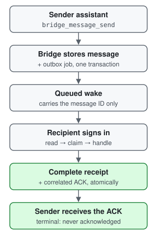

# Agent Bridge

A small, self-hosted [MCP](https://modelcontextprotocol.io) server that lets
**two AI assistants leave each other messages**. One assistant sends a bounded
message, status update or handoff request; the bridge stores it, wakes the
other assistant with an event that carries only a message ID, and records the
recipient's receipt and acknowledgement atomically.

It is built for one owner running two assistants on different platforms, such
as an OpenAI dot (MCP Events) and a Grok Bot (webhooks). Each assistant signs in
with its own OAuth token and can only send to the other one.

> **Messages are data, never permission.** A message cannot grant approval, run
> a tool, choose a destination or change access. The receiving assistant treats
> it as inbox content and acts only under its owner's existing, independently
> authorized workflow.

## How it works

<p align="center">
  
</p>

The reverse direction works the same way. An **ACK** means the recipient
handled the received data, not that any requested task is done. ACKs are
terminal: an ACK is never acknowledged in turn, which prevents reciprocal ACK
loops.

## Set up with your assistant

The fastest path is to let one of your assistants guide you. Copy this prompt
into your **OpenAI dot** or **Grok Bot** (it walks you through both sides):

```text
Help me set up Agent Bridge (https://github.com/aravhawk/agent-bridge) between
two of my assistants. Work step by step. Go ahead with safe, read-only
inspection and local checks, and with routine steps I have already approved;
stop and ask me at real decisions and before you create, change or delete any
account, resource, credential, permission or grant, or any existing live
configuration. Never skip a confirmation a platform requires.

Ground rules:
- Read the repository first: README.md, docs/configuration.md,
  docs/inbox-policy.md and schema.sql. Then check the CURRENT official docs for
  each platform I use (Vercel, my Postgres host, my OAuth provider, and the
  OpenAI MCP Events or xAI Grok Bot docs). Prefer them over your memory, and
  tell me when something differs.
- Never ask me to paste a secret, token, key, password or database URL into
  this chat. Tell me where to enter it (for example a Vercel environment
  variable marked Sensitive) and confirm only that it is set.
- Never use another person's repository, deployment, domain, OAuth app or
  redirect URL. Use only the callback/redirect URLs my assistant hosts show me.
- Do not enable anything I did not ask for.

1. Detect my situation: a fresh install, or an existing deployment I am
   updating? If existing, read my current configuration names (not values)
   first and preserve them; change nothing until I confirm.
2. Repository: help me fork the repo, or create my own repository from it, so
   that my own Vercel project deploys from my own GitHub repository (Vercel's
   GitHub integration needs the repository owner). Keep the original as the
   `upstream` remote for later updates.
3. Prerequisites: Node.js 24.22.1 or newer within 24.x for local checks; a
   Vercel project with Vercel Queues; a Postgres database with a publicly
   trusted TLS certificate (sslmode=require), with schema.sql applied once;
   a stable HTTPS origin for the bridge (my project's *.vercel.app domain
   works; a custom domain is optional); and two short peer IDs (one `events`
   peer, one `webhook` peer).
4. OAuth: an issuer that signs JWT access tokens (not opaque tokens). One
   client per assistant, each with its own audience
   `<origin>/bridge/<peer>/mcp` and exactly its two directional scopes
   (`bridge:send:<other>` and `bridge:ack:<self>`). Pin the single allowed
   subject (me) by its SHA-256 hash.
5. Vercel environment variables: help me set BRIDGE_PUBLIC_ORIGIN,
   BRIDGE_PEERS, BRIDGE_OAUTH_ISSUER, BRIDGE_ALLOWED_SUBJECT_SHA256,
   DATABASE_URL, BRIDGE_SUBSCRIPTION_STORAGE_KEY (32 random bytes, base64) and
   the webhook peer's BRIDGE_PEER_<ID>_* settings, marking secrets Sensitive.
   Leave every readiness gate closed for now, then deploy. Vercel applies
   environment changes only to new deployments, so redeploy after every
   change in the steps below.
6. Connect each assistant to its MCP URL with the redirect URLs its host shows:
   - OpenAI: hosted MCP Events work in Work chats on ChatGPT web, desktop Cloud
     and dots. The Responses API and Agents SDK do not support them.
     Follow the manual guide below to render the plugin ZIP with approved
     public OAuth metadata, install/connect it as a plugin, verify tools AND
     events, and ask the host what to monitor and how to handle each event.
   - Grok: a Grok Bot routine webhook uses a Bearer key and answers HTTP 200,
     so set BRIDGE_PEER_<ID>_WEBHOOK_AUTH=bearer. Grok Automations webhooks
     are different: Standard Webhooks signatures and HTTP 202.
     Bind the routine to the receiver workflow in docs/inbox-policy.md;
     configuring a URL and key alone does not implement message handling.
   Have each assistant call bridge_health and compare its `caller` field
   (role, scopes, tools) with what the host shows.
7. Open the readiness gates one at a time, redeploying and checking
   bridge_health after each:
   BRIDGE_OAUTH_CONTRACT_VERIFIED=true; BRIDGE_SUBSCRIPTIONS_ENABLED=true (then
   the events peer subscribes); the webhook peer's receiver ID and
   contract attestation; BRIDGE_RECEIVER_POLICY=inbox-v1 once both receivers
   follow docs/inbox-policy.md; BRIDGE_DELIVERY_ENABLED=true last.
8. Verify end to end in BOTH directions with one harmless, non-sensitive
   message each way: the recipient reads, claims, handles and completes it,
   and the sender receives exactly one ACK. ACKs are terminal: never reply to
   or acknowledge an ACK, which keeps the test from creating reciprocal ACKs.

Leave the optional features (WAKE/SYNC batching, the QStash scheduler and
private Blob attachments) off unless I ask for them later; each one needs its
own setup and verification.
```

The prompt is guidance for your assistant, not an automated installer: it
should explain each step, check the current provider documentation, and ask
before it creates or changes anything.

## Security model

- **Resource server only.** Your OAuth provider issues and refreshes tokens.
  The bridge verifies RS256 JWTs against a pinned issuer, a per-peer audience
  (`<origin>/bridge/<peer>/mcp`) and a single allowed subject (the owner). It
  never issues, stores or logs tokens.
- **Directional scopes.** Each peer holds `bridge:send:<other>` and
  `bridge:ack:<self>`: it can send only to its counterpart and read, claim and
  acknowledge only messages addressed to itself.
- **Data, not instructions.** Text is at most 4 KiB, expires within one hour
  (up to 12 hours for opt-in SYNC data) and is validated against a fixed
  envelope. There are no free-form routes, task selectors, URLs or tool
  choices. Reads return `authority: "peer_data_requires_user_workflow"`.
- **Closed by default.** Subscriptions, delivery and the receiver policy are
  separate operator gates. Each stays off until you attest it, and readiness
  is rechecked on every call.
- **Hardened outbound HTTP.** Callbacks and webhooks are HTTPS only, resolved
  to public unicast addresses, pinned to the checked address with TLS verified
  on the original hostname, never redirected, and bounded.
- **Secrets at rest.** Subscription callback URLs and secrets are encrypted
  with AES-256-GCM and bound to the subscription ID. Webhook-peer secrets live
  only in environment variables.
- **Honest guarantees.** Storage, receipts and ACKs are exactly-once per
  message. External agent actions are not: HTTP 2xx proves transport, not
  that an assistant woke up or acted. See [architecture](docs/architecture.md).

To report a vulnerability, follow [SECURITY.md](SECURITY.md); do not open a
public issue.

<details>
<summary><strong>Manual setup guide</strong> (install, configure, deploy, verify)</summary>

### 1. Your own repository and Vercel project

Clone this repository to review it locally. To deploy, **fork it** (or create
your own repository from it) and import *your* repository into *your own*
Vercel project: Vercel's Git integration needs the owner of the GitHub
repository ([Vercel for GitHub](https://vercel.com/docs/git/vercel-for-github)).
Keep this repository as `upstream` for updates:

```sh
git clone https://github.com/<you>/agent-bridge.git && cd agent-bridge
git remote add upstream https://github.com/aravhawk/agent-bridge.git
```

### 2. Install and check locally

Node.js 24.22.1 or newer within major 24 is required. The source is
TypeScript that Node runs directly, so there is no build step:

```sh
npm ci --ignore-scripts
npm run typecheck        # strict TypeScript, tests included
npm run compile:check    # clean emit to dist/ and load the emitted entry points
npm test                 # offline: no network, credentials or database
npm audit
```

Vercel compiles `api/*.ts` (and the `src/` files they import) at deploy time
without type checking, which is why `npm run typecheck` runs in CI.

### 3. Peers, database and OAuth

1. **Peers.** For example `BRIDGE_PEERS=alice:events,bob:webhook`: `alice`
   gets `/bridge/alice/mcp` with `bridge:send:bob` and `bridge:ack:alice`;
   `bob` gets `/bridge/bob/mcp` with `bridge:send:alice` and `bridge:ack:bob`.
2. **Database.** Create a dedicated Postgres database whose host has a
   publicly trusted TLS certificate, and apply the schema once:
   `psql "$DATABASE_URL" -f schema.sql`.
3. **OAuth.** Use an issuer that signs JWT access tokens and serves
   `/.well-known/jwks.json` at a bare HTTPS origin. Create one public client
   per peer (PKCE, no client secret) with the redirect URL that peer's
   assistant host shows you. Tokens must carry that peer's audience and its
   two scopes (plus `offline_access` if the host refreshes). With Clerk,
   enable JWT access tokens: the default opaque tokens are rejected. Pin
   yourself as the only subject by its hash:
   `printf %s "$YOUR_SUB" | shasum -a 256`.

### 4. Deploy

Choose the bridge's public origin: your project's stable `*.vercel.app`
domain works, and a custom domain is optional. Set these Production
variables in the Vercel project, marking secrets Sensitive:

```text
BRIDGE_PUBLIC_ORIGIN=https://bridge.example.com
BRIDGE_PEERS=alice:events,bob:webhook
BRIDGE_OAUTH_ISSUER=https://auth.example.com
BRIDGE_ALLOWED_SUBJECT_SHA256=<hex digest>
DATABASE_URL=<postgres URL with sslmode=require>
BRIDGE_SUBSCRIPTION_STORAGE_KEY=<openssl rand -base64 32>
BRIDGE_PEER_BOB_WEBHOOK_URL=<bob's webhook endpoint>
BRIDGE_PEER_BOB_WEBHOOK_SECRET=<whsec_... for Standard Webhooks, or the Bearer key>
BRIDGE_PEER_BOB_WEBHOOK_AUTH=<standard-webhooks (default) or bearer>
```

`vercel.json` routes every path to the MCP function, keeps the queue consumer
and `/api/cron` out of that catch-all, and declares the queue trigger topic,
which must equal `BRIDGE_QUEUE_TOPIC` (both default to the same value).

Then deploy to Production: push to your repository's production branch, or
use **Redeploy** in the Vercel dashboard. Vercel compiles the TypeScript
during the deployment; there is no local prebuild. Environment variable
changes apply only to new deployments, so redeploy after every configuration
change below, including each readiness gate.

Check the public boundary (no credentials needed):

```sh
python3 scripts/check_v1.py --origin https://bridge.example.com --peers alice,bob \
  --issuer https://auth.example.com --auth-configured
```

### 5. Connect and open the gates

For the OpenAI events peer, render the plugin using only your approved public
origin, issuer and that peer's public OAuth client ID (replace the example
values and peer IDs):

```sh
python3 scripts/package_plugin.py --origin https://bridge.example.com --peer alice \
  --counterpart bob --issuer https://auth.example.com --client-id YOUR_PUBLIC_CLIENT_ID
```

The script writes `.reports/plugin-<version>.zip` locally; it does not upload
or install anything. Follow OpenAI's [connect and test guide](https://developers.openai.com/plugins/deploy/connect-chatgpt)
to install the packaged plugin from a local marketplace, or connect your
custom MCP server as a plugin. Public marketplace publication is not required.
Sign in with the configured OAuth client and verify the discovered tools.
Once subscriptions are enabled below, check that `bridge.message.received`
appears alongside tools on the plugin page; rescan after tools or events
change. In a Work chat (web, or desktop with Cloud selected) or a dot, tell
the host to monitor this peer's inbox and follow
[the receiver contract](docs/inbox-policy.md) when an event arrives. Confirm
the subscription succeeds; a tool-only connection does not establish monitoring.

For Grok Bot, create a webhook-triggered routine whose instructions implement
the same receiver contract: read the message ID, claim, handle and complete,
with terminal ACK handling. Bind its actual URL and Bearer key to the bridge.
The URL and key configure transport; the routine supplies the receiver workflow.

Call `bridge_health` from each assistant through its MCP connection.
Its `caller` field shows the verified role, scopes and offered tools; compare
it with what the host displays. Then open the gates in order, redeploying and
rechecking `bridge_health` after each:

1. `BRIDGE_OAUTH_CONTRACT_VERIFIED=true`, once both peers' real tokens carry
   the right audience and scopes.
2. `BRIDGE_SUBSCRIPTIONS_ENABLED=true`; the events peer then subscribes.
3. Optionally, the one-time [webhook diagnostic](docs/configuration.md#one-time-webhook-diagnostic).
4. `BRIDGE_PEER_BOB_RECEIVER_ID=agent-inbox-bridge`,
   `BRIDGE_PEER_BOB_WEBHOOK_CONTRACT_VERIFIED=true` and
   `BRIDGE_RECEIVER_POLICY=inbox-v1`, once both receivers follow the
   [inbox contract](docs/inbox-policy.md).
5. `BRIDGE_DELIVERY_ENABLED=true`.

**Host notes.** OpenAI hosted MCP Events cover Work chats on ChatGPT web,
desktop Cloud and dots (not the Responses API or Agents SDK); follow the
[MCP Events setup](https://developers.openai.com/plugins/build/mcp-events).
A [Grok Bot routine webhook](https://docs.x.ai/grok-bot/skills-routines-and-automations)
uses a Bearer key and HTTP 200 (`_WEBHOOK_AUTH=bearer`);
[Grok Automations webhooks](https://docs.x.ai/grok/automations/webhooks) use
Standard Webhooks signatures and HTTP 202. Details:
[provider compatibility](docs/configuration.md#provider-compatibility).

### 6. Verify receipts

Send one harmless message in each direction. The recipient reads it
(`bridge_read`), claims it (`bridge_receipt_claim`), handles it, and completes
it (`bridge_receipt_complete`); the sender should receive exactly one ACK
event. `bridge_status` on the message ID shows delivery attempts, the receipt
and the ACK. Never reply to an ACK.

### Troubleshooting

| Symptom | Likely cause |
|---|---|
| `401` with a `WWW-Authenticate` challenge | Token expired, wrong issuer or audience, or an opaque (non-JWT) token |
| `403 forbidden_subject` / `insufficient_scope` | The subject is not the pinned owner, or the peer's two scopes are missing |
| `receiver_readiness_required` | A readiness gate is still closed; check `bridge_health` → `readiness` |
| `storage_tls_configuration_required` | `DATABASE_URL` lacks `sslmode=require` or uses client certificates |
| `recipient_subscription_required` | The events peer has no live subscription; it must subscribe (and renew before `refreshBefore`) |
| `bridge_status` shows `lastError: permanent_http` | The webhook receiver rejected the request; check `_WEBHOOK_AUTH` (Bearer vs Standard Webhooks) and its key |

### Updating and rolling back

```sh
git fetch upstream && git merge --ff-only upstream/main
npm ci --ignore-scripts && npm run typecheck && npm test
git push   # your Vercel project redeploys from your repository
```

This fast-forward assumes your fork has no commits of its own; otherwise merge
or rebase as usual. To roll back, promote the previous production deployment
in Vercel. Every optional feature has its own documented rollback.

### Configuration reference

The full reference, including the diagnostic and canary procedures, is in
[docs/configuration.md](docs/configuration.md).

| Variable | Required | Purpose |
|---|---|---|
| `BRIDGE_PUBLIC_ORIGIN` | yes | Public HTTPS origin. Unset means compatibility mode (below) |
| `BRIDGE_PEERS` | yes | `<id>:events,<id>:webhook` |
| `BRIDGE_OAUTH_ISSUER` | yes | Issuer origin; JWKS at `/.well-known/jwks.json` |
| `BRIDGE_ALLOWED_SUBJECT_SHA256` / `BRIDGE_ALLOWED_SUBJECT` | one | The single allowed token subject |
| `BRIDGE_OAUTH_SCOPE_CLAIM` | no | `scope` (default), `scp` or `scopes` |
| `DATABASE_URL` | yes | Postgres with a publicly trusted TLS certificate; connections use `verify-full` |
| `BRIDGE_SUBSCRIPTION_STORAGE_KEY` | yes | 32-byte base64 key for subscription secrets |
| `BRIDGE_PEER_<ID>_WEBHOOK_URL` / `_WEBHOOK_SECRET` / `_WEBHOOK_AUTH` | for delivery | Webhook endpoint and `standard-webhooks` (default) or `bearer` |
| `BRIDGE_PEER_<ID>_RECEIVER_ID` / `_WEBHOOK_CONTRACT_VERIFIED` | for delivery | Webhook receiver attestations |
| `BRIDGE_OAUTH_CONTRACT_VERIFIED`, `BRIDGE_SUBSCRIPTIONS_ENABLED`, `BRIDGE_RECEIVER_POLICY`, `BRIDGE_DELIVERY_ENABLED` | for delivery | Readiness gates, all closed by default |
| `BRIDGE_SERVICE_NAME` | no | Display label (`Agent Bridge` for new deployments); renames no peer, route, audience or protocol ID |
| `BRIDGE_MESSAGE_PROTOCOL`, `BRIDGE_RECEIVER_ID`, `BRIDGE_QUEUE_TOPIC`, `BRIDGE_QUEUE_REGION`, `BRIDGE_REQUIRE_ISSUER_UNDER_ORIGIN`, `BRIDGE_DATABASE_HOST_SUFFIX` | no | Protocol/storage identity and optional hardening |
| Optional features | no | See below; all off until configured |

**Compatibility mode.** This project began as a private deployment between two
assistants named `jarvis` and `friday`. With `BRIDGE_PUBLIC_ORIGIN` unset, the
bridge reproduces that deployment exactly: its origin, peers, scope strings,
the `jarvis-friday/1` protocol ID, tool, readiness and error names, and the
`FRIDAY_*` environment variables, so existing installs keep working unchanged.
New deployments should always set `BRIDGE_PUBLIC_ORIGIN`. Both protocol IDs
are accepted on input in every mode. See
[deployment identity](docs/configuration.md#deployment-identity).

### Links

[Architecture](docs/architecture.md) ·
[Configuration](docs/configuration.md) ·
[Inbox contract](docs/inbox-policy.md) ·
[Scheduler](docs/scheduler.md) ·
[Attachments](docs/attachments.md) ·
[Task kernel](docs/task-kernel.md) ·
[Contributing](CONTRIBUTING.md) ·
[Security](SECURITY.md)

</details>

<details>
<summary><strong>MCP surface</strong></summary>

| Tool | Who | What |
|---|---|---|
| `bridge_health` | both | Authenticated configuration and readiness; no data access |
| `bridge_message_send` | both (send scope) | Send message, status or handoff-request data to the counterpart |
| `bridge_read` | recipient | Read a stored message by the ID from its wake event |
| `bridge_receipt_claim` / `bridge_receipt_complete` | recipient | Claim with a 60 s recovery lease, then complete and atomically create the ACK |
| `bridge_status` | both | Delivery and receipt evidence for one known message |
| `bridge_subscription_status` | events peer | Own subscriptions and renewal observations (no secrets) |
| `bridge_webhook_diagnostic` | events peer (send scope) | One-time, operator-armed transport check of the webhook peer |
| `bridge_inbox_read` | WAKE/SYNC recipient | Start-of-turn read of unacknowledged SYNC batches |
| `bridge_attachment_begin` / `_finalize` / `_download` | both, when attachments are on | Private direct-to-storage file transfer |

The events peer can also call `events/list`, `events/subscribe` and
`events/unsubscribe` for `bridge.message.received`. The deployed entry point
(`api/index.ts`) also opts in to a task coordination layer (`bridge_task_*`),
offered only once the OAuth contract is verified and delivery is enabled; see
[docs/task-kernel.md](docs/task-kernel.md).

</details>

<details>
<summary><strong>Optional features</strong> (off until configured and verified)</summary>

Each feature is off by default and needs its own setup, verification and
rollback; leave them off until the core two-way flow works.

- **WAKE/SYNC batching** (`BRIDGE_WAKE_SYNC_RECIPIENTS=<peer>`). Senders may
  mark dependency-free FYI updates `class: "sync"`; they are batched into at
  most one wake per America/Chicago even hour instead of one wake each. With
  a healthy scheduler the nominal target is that queued data waits no more
  than two elapsed hours; late runs, missed ticks or downtime delay delivery
  until the next successful run catches up. So anything needing action, a
  decision, a reply or timely delivery, or that a workflow depends on, stays
  WAKE, and handoff requests are always WAKE. Each handled
  batch gets one ACK. The receiver must follow the
  [flagged receiver contract](docs/inbox-policy.md#flagged-receiver-contract).
  See [wake/sync delivery](docs/configuration.md#wakesync-delivery-classes-default-off)
  and [rollout and rollback](docs/configuration.md#rollout-and-rollback).
- **Scheduled flush** (`/api/cron`). Batches are flushed by an external
  scheduled tick: Upstash QStash with signed deliveries
  (`QSTASH_CURRENT_SIGNING_KEY`, `QSTASH_NEXT_SIGNING_KEY`,
  `BRIDGE_QSTASH_DESTINATION_URL`), or any scheduler with
  `Authorization: Bearer $CRON_SECRET`. Plan a schedule with
  `node scripts/qstash-schedule-plan.ts --dry-run --destination <url>`, which
  sends nothing. See [scheduler](docs/scheduler.md).
- **Private attachments** (`BRIDGE_ATTACHMENTS_ENABLED=true`, `BLOB_STORE_ID`,
  optional `BRIDGE_ATTACHMENT_MAX_BYTES`). Files go directly to and from a
  connected private Vercel Blob store through short-lived, single-artifact
  URLs (500 MB default, 1 GB cap); recipients verify size and SHA-256. See
  [attachments](docs/attachments.md).

</details>

## Limitations

- Exactly two peers and one owner (a single allowed subject), with state in
  one database row: sized for one owner's traffic (at most 100 live messages,
  with backpressure beyond that).
- The OAuth issuer must be a bare HTTPS origin serving `/.well-known/jwks.json`.
- Queueing uses Vercel Queues (`queue/v2beta` triggers).

## Development

```sh
npm ci --ignore-scripts
npm run typecheck
npm run compile:check
npm test
python3 scripts/audit_repo.py   # secret/identifier audit of the index and history
```

See [CONTRIBUTING.md](CONTRIBUTING.md). Licensed under the
[Apache License 2.0](LICENSE).
